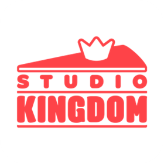

## Career

| | Company | Period | Role | Projects |
|:-:|---|---|---|---|
|  | Devsisters (Studio Kingdom) | 2018.12&nbsp;‑&nbsp;2026.06 | Client Software Engineer | Cookie Run: Kingdom, Cookie Run: OvenSmash |
|  | PlugVR (now DIVEXR) | 2017.06&nbsp;‑&nbsp;2018.08 | Development Team Lead | XR content delivered to public institutions and companies |

## Skills

  
  
  
  
  
  
  
  
  
  
  
  
  
  
  

## Projects

###  Open Source

| Year | Pick | Repository | Description |
|:-:|:-:|---|---|
| 2026 |  | [open-game-works-core-impl](https://github.com/wnsrn3436/open-game-works-core-impl) | Core of open-game-works: Godot client core, TypeScript server core, contract and data tools |
| 2026 |  | [open-game-works-core](https://github.com/wnsrn3436/open-game-works-core) | Harness that lets AI agents build server-client games |

###  Games

| Year | Pick | Repository | Description |
|:-:|:-:|---|---|
| 2015 |  | [game-sketch-ball](https://github.com/wnsrn3436/game-sketch-ball) | A ball bouncing through pencil drawn blocks |
| 2013 |  | [game-winter-survival](https://github.com/wnsrn3436/game-winter-survival) | Survival game in a snowy forest where you keep warm and fed |
| 2012 |  | [game-myth-of-legend-2](https://github.com/wnsrn3436/game-myth-of-legend-2) | RTS with 2v2 multiplayer and unit data loaded from external files |
| 2009 |  | [game-age-of-war](https://github.com/wnsrn3436/game-age-of-war) | Top down arena battle made for a community event |
| 2009 |  | [game-myth-of-legend](https://github.com/wnsrn3436/game-myth-of-legend) | RTS with a minimap, chat and a standalone map editor |
| 2009 |  | game-lyman-early  | Vertical scrolling shooter with bullet patterns inspired by Touhou Project |
| 2008 |  | [game-3d-shudden-attack](https://github.com/wnsrn3436/game-3d-shudden-attack) | FPS made with GameMaker's built in 3D functions |
| 2008 |  | [game-zombie-assault](https://github.com/wnsrn3436/game-zombie-assault) | Action game fighting mutating zombies with a sword and guns |
| 2008 |  | [game-woncraft](https://github.com/wnsrn3436/game-woncraft) | RTS with a map editor, triggers and a minimap |
| 2008 |  | [game-s-war](https://github.com/wnsrn3436/game-s-war) | Two player co-op shooter on one keyboard |
| 2008 |  | [game-photon-cannon-defense](https://github.com/wnsrn3436/game-photon-cannon-defense) | StarCraft themed defense with drag selection and move orders |
| 2008 |  | [game-riakeunia](https://github.com/wnsrn3436/game-riakeunia) | Vertical scrolling shooter with dialogue and boss fights |
| 2007 |  | [game-war-and-peace](https://github.com/wnsrn3436/game-war-and-peace) | RTS with two factions and a map editor |
| 2007 |  | [game-crazy-zombie-defense-2](https://github.com/wnsrn3436/game-crazy-zombie-defense-2) | Sequel to game-crazy-zombie-defense, with picked up weapons that follow the player |
| 2007 |  | [game-crazy-zombie-defense](https://github.com/wnsrn3436/game-crazy-zombie-defense) | Mouse controlled zombie defense |
| 2007 |  | [game-untitled-rpg](https://github.com/wnsrn3436/game-untitled-rpg) | Hunting RPG with shops for shields and skills |
| 2007 |  | [game-cant-clear-it](https://github.com/wnsrn3436/game-cant-clear-it) | Unbeatable shooter made for a community event |
| 2007 |  | [game-convict-drive](https://github.com/wnsrn3436/game-convict-drive) | Driving action game with stages, a boss fight and lives |
| 2007 |  | [game-archon-adventure](https://github.com/wnsrn3436/game-archon-adventure) | StarCraft themed dodging game with stages and boss fights |
| 2007 |  | [game-bullet-dodge](https://github.com/wnsrn3436/game-bullet-dodge) | Dodging game made only with GameMaker's drag and drop actions |
| 2007 |  | [game-powerpoint-rpg](https://github.com/wnsrn3436/game-powerpoint-rpg) | PowerPoint RPG with a health bar, levels, skills and quests |
| 2007 |  | [game-jolacraft](https://github.com/wnsrn3436/game-jolacraft) | RTS made entirely in PowerPoint 2003 |

###  Tools and Libraries

| Year | Pick | Repository | Description |
|:-:|:-:|---|---|
| 2014 |  | [util-networking-with-space](https://github.com/wnsrn3436/util-networking-with-space) | GameMaker: Studio networking extension that divides players into spaces |
| 2014 |  | [util-hyperlinks-downloader](https://github.com/wnsrn3436/util-hyperlinks-downloader) | Downloads the files of the links selected on a web page one by one |
| 2014 |  | [util-7z-extractor](https://github.com/wnsrn3436/util-7z-extractor) | Drag and drop extractor for .7z and split archives |
| 2013 |  | [util-fn-simple-scripts](https://github.com/wnsrn3436/util-fn-simple-scripts) | Networking scripts with player management and space based messaging |
| 2013 |  | [util-k-dll](https://github.com/wnsrn3436/util-k-dll) | DLL for Korean IME composition, input language switching and CP949 / UTF-8 conversion |
| 2012 |  | [util-instance-nearest](https://github.com/wnsrn3436/util-instance-nearest) | C++ DLL that finds the nearest instance within a range |
| 2012 |  | [util-fn-file-send-scripts](https://github.com/wnsrn3436/util-fn-file-send-scripts) | File transfer from a server to every client with MD5 checks |
| 2012 |  | [util-circular-array-searching](https://github.com/wnsrn3436/util-circular-array-searching) | C++ DLL that finds the nearest object on a grid |
| 2012 |  | util-hanforest  | Tools that split a large file into image posts and join it back on download |
| 2012 |  | [util-gamemaker-linkedlist](https://github.com/wnsrn3436/util-gamemaker-linkedlist) | C++ doubly linked list with a ds_list style API |
| 2012 |  | [util-dlrc-zip](https://github.com/wnsrn3436/util-dlrc-zip) | GameMaker 8 archive library that bundles files into one .dlrc |
| 2011 |  | [util-39dll-simple-scripts](https://github.com/wnsrn3436/util-39dll-simple-scripts) | GameMaker 8 networking scripts built on 39DLL |
| 2010 |  | [util-jw2-miniwizardnet](https://github.com/wnsrn3436/util-jw2-miniwizardnet) | Client and server that revive WizardNet, the Battle.net of Jurassic Primitive War 2 |

###  Reverse Engineering

| Year | Pick | Repository | Description |
|:-:|:-:|---|---|
| 2019 |  | re-atrox-launcher  | Launcher and patcher that add window mode, 1280x1024 and custom data packs to Atrox |
| 2018 |  | re-syw2plus-launcher  | Launcher that starts Seven Years War 2+ in normal, scenario or map editor mode |
| 2018 |  | [re-syw2plus-usemap-patch](https://github.com/wnsrn3436/re-syw2plus-usemap-patch) | Byte patch notes that make Seven Years War 2+ load the units placed in a map |
| 2016 |  | [re-atrox-parameter-tools](https://github.com/wnsrn3436/re-atrox-parameter-tools) | Tools that extract map parameters to text, pack them back and patch the game to read them |
| 2015 |  | [re-atrox-1280x1024](https://github.com/wnsrn3436/re-atrox-1280x1024) | Byte patch notes that run Atrox at 1280x1024 and move the UI |
| 2015 |  | [re-atrox-window-mode](https://github.com/wnsrn3436/re-atrox-window-mode) | Byte patch notes that run Atrox in an 800x600 window |
| 2014 |  | [re-jw2-trk-resolution-settings](https://github.com/wnsrn3436/re-jw2-trk-resolution-settings) | Tool that runs The Ranker at any resolution the monitor supports |
| 2014 |  | [re-hq-packer](https://github.com/wnsrn3436/re-hq-packer) | Unpacks and repacks the encrypted Data.hq of the HQ Team games |
| 2013 |  | re-hq-map-editor-unlock  | Analysis and patches that revive the hidden map editors of three HQ Team games |
| 2013 |  | [re-atrox-pak-extractor](https://github.com/wnsrn3436/re-atrox-pak-extractor) | Extracts atrox.pak with its folder structure |
| 2011 |  | [re-gamemaker-lib-lock-unlock](https://github.com/wnsrn3436/re-gamemaker-lib-lock-unlock) | Unlocks GameMaker action libraries (.lib) for editing |
| 2011 |  | [re-jw2-trc-extractor](https://github.com/wnsrn3436/re-jw2-trc-extractor) | Unpacks TRC archives and writes a repack listing |
| 2010 |  | [re-jw2-spz-editor](https://github.com/wnsrn3436/re-jw2-spz-editor) | Converter between SPZ unit images and BMP |
| 2010 |  | [re-jw2-unit-speed-editor](https://github.com/wnsrn3436/re-jw2-unit-speed-editor) | Editor for per frame unit speeds in CEI files |
| 2010 |  | [re-jw2-scr-editor](https://github.com/wnsrn3436/re-jw2-scr-editor) | Converter between SCR screen images and BMP |
| 2010 |  | [re-jw2-chr-extractor](https://github.com/wnsrn3436/re-jw2-chr-extractor) | Extracts graphics, sound and stats from CHR files |
| 2010 |  | [re-jw2-version-changer](https://github.com/wnsrn3436/re-jw2-version-changer) | Rewrites the version date inside The Ranker's trc archive |
| 2010 |  | [re-atrox-usemap-maker](https://github.com/wnsrn3436/re-atrox-usemap-maker) | Patches Atrox's pak so user made maps play from the campaign mission screen |

## School Projects

| Year | Type | Pick | Repository | Description |
|:-:|:-:|:-:|---|---|
| 2018 |  |  | [game-angry](https://github.com/wnsrn3436/game-angry) | Unity 2D shooter where a red bird hits flocks of birds with charge shots |
| 2018 |  |  | game-dont-forget-me  | SteamVR shooter where a doll fends off mold monsters with a toy gun |
| 2018 |  |  | [util-art-animation](https://github.com/wnsrn3436/util-art-animation) | AR app that overlays guide drawings on paper and animates the finished drawing |
| 2018 |  |  | game-strange-imagination  | Educational VR that teaches children how to brush their teeth |
| 2018 |  |  | [game-zoo-tycoon](https://github.com/wnsrn3436/game-zoo-tycoon) | Android game where you drag animals and zookeepers onto a grassland |
| 2017 |  |  | [util-java-pos](https://github.com/wnsrn3436/util-java-pos) | Java Swing POS for table layout, orders, products, members and sales |
| 2017 |  |  | [util-simple-calculator](https://github.com/wnsrn3436/util-simple-calculator) | Android calculator for the four basic operations |
| 2017 |  |  | util-spy-image  | Three tools that split a file into PNG pieces for posts and join it back |
| 2017 |  |  | [util-company-manager](https://github.com/wnsrn3436/util-company-manager) | C console program that manages employees with a hand written list and dictionary |
| 2017 |  |  | [util-class-manager](https://github.com/wnsrn3436/util-class-manager) | C console program that sorts scores and prints averages and standard deviations |
| 2014 |  |  | [web-shopping-shop](https://github.com/wnsrn3436/web-shopping-shop) | One page shopping site with a parallax background and gallery |
| 2014 |  |  | [game-fortress](https://github.com/wnsrn3436/game-fortress) | Two player Flash artillery game with destructible terrain |
| 2014 |  |  | [util-notepad-master-collection](https://github.com/wnsrn3436/util-notepad-master-collection) | Notepad clone down to its menus, shortcuts and menu states |
| 2014 |  |  | [game-way-of-the-sword](https://github.com/wnsrn3436/game-way-of-the-sword) | Action game that ports GameMaker's object model to VB.NET |
| 2014 |  |  | [web-command-windows](https://github.com/wnsrn3436/web-command-windows) | Classic ASP homepage that works like the Windows command prompt |
| 2014 |  |  | [game-hunminjeongeum](https://github.com/wnsrn3436/game-hunminjeongeum) | Korean initial consonant word game that checks words against the Standard Korean Language Dictionary |

## Company Projects

| Year | Pick | Project | Description |
|:-:|:-:|---|---|
| 2026 |  | Cookie Run: OvenSmash | Ranked mode outgame, unified back button handling and TLS, memory optimization, build and data pipelines |
| 2018 |  | Cookie Run: Kingdom | World map, shop, in-app purchases and gacha, Guild Museum, Square, build and editor tools |
| 2018 |  | Drawing Comes True | AR app that turns a drawing on paper into a rigged 3D character |
| 2018 |  | PlugVR | Android launcher app for the PlugVR AR content platform |
| 2018 |  | Vision City | AR content where a virtual city rises when the Big Ben and Eiffel Tower markers meet |
| 2018 |  | AR Marketing Mobile | Marketing AR app that registers images from Firebase as EasyAR targets |
| 2018 |  | AR Brochure | University promotion AR app with brochure videos and GPS campus directions |
| 2017 |  | Wave Force AR | Marker AR app that brings up a wave power generator on a printed image |
| 2017 |  | NC Ocean Tech | PC VR promotional content showing how a wave power generator works |
| 2017 |  | Be My Idol | PC VR where children try firefighting, a spaceship, a roller coaster and a xylophone |
| 2017 |  | Cave & Seabed Exploration | Two VR experiences touring the sea in a submersible and a cave along its tunnels |
| 2017 |  | By Stealth | 1 vs 1 police and thief multiplayer VR |
| 2017 |  | HoloRoom | Mixed reality escape room game for HoloLens |
| 2017 |  | Accidentally Dungeon | HTC Vive VR action game fighting dungeon monsters with a bow |
